<h1 align="center">ESPN Fantasy Tools</h1>

<b>Your ESPN fantasy football league, with the tools ESPN doesn't have.</b> 
A private website for one league: live charts of every matchup, the league's record book, every way the rest of the
season can go, a breakdown of every trade offer, and more. Free to run, and yours.

  
  
  

<picture>
  <source media="(prefers-color-scheme: dark)" srcset="docs/images/home-dark.webp">
  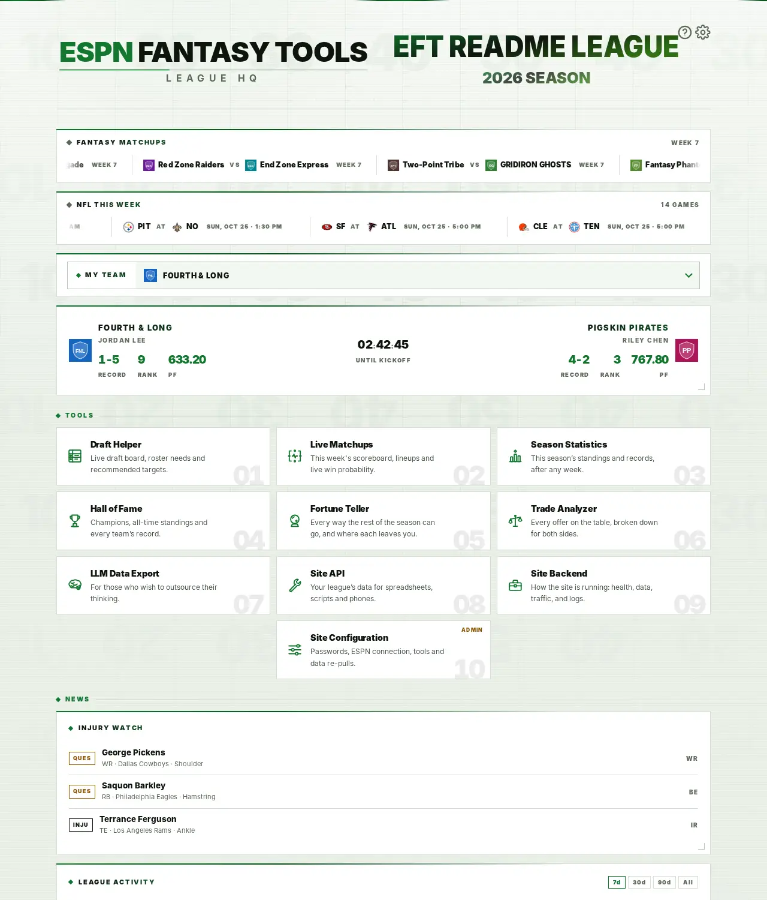
</picture>

> [!IMPORTANT]
> **Setting up your own copy?** Start with the **[setup guide](setup-guide.md)**. It walks you from forking this
> repository to finishing the setup wizard, in about twenty minutes. This page describes the site once it is
> running. Every screenshot here is of a demo league, the *EFT README League*.

---

## Contents

- [What it is](#what-it-is)
- [Signing in](#signing-in) · [On your phone](#on-your-phone)
- [The home page](#the-home-page)
- [On every page: help and settings](#on-every-page-help-and-settings)
- [The tools](#the-tools)
  - [Draft Helper](#draft-helper) · [Live Matchups](#live-matchups) · [Hall of Fame](#hall-of-fame) ·
    [Fortune Teller](#fortune-teller) · [Trade Analyzer](#trade-analyzer) · [LLM Data Export](#llm-data-export) ·
    [Site API](#site-api) · [Site Backend](#site-backend)
- [Site Configuration](#site-configuration)
- [The setup wizard](#the-setup-wizard)
- [How it works](#how-it-works)
- [Keeping your copy up to date](#keeping-your-copy-up-to-date)
- [Questions and issues](#questions-and-issues)

---

## What it is

The site reads your league from ESPN, keeps it up to date on its own, and puts it behind one password you share with
your league. Nobody without it sees anything at all. It runs on your own free Cloudflare account, and it works with
any ESPN fantasy football league: your scoring, your roster shape, your playoff rules.

| | Tool | What it is for | Starts as |
| --- | --- | --- | --- |
| 📋 | [Draft Helper](#draft-helper) | Live draft board, roster needs and recommended targets | Visible |
| 📈 | [Live Matchups](#live-matchups) | This week's scoreboard, lineups and live win probability | Visible |
| 🏆 | [Hall of Fame](#hall-of-fame) | Champions, all-time standings and every team's record | Visible |
| 🔮 | [Fortune Teller](#fortune-teller) | Every way the rest of the season can go, and where each leaves you | Visible |
| 🤝 | [Trade Analyzer](#trade-analyzer) | Every offer on the table, broken down for both sides | Visible |
| 🤖 | [LLM Data Export](#llm-data-export) | The whole league in one file, for an AI chat assistant | Visible |
| 🔧 | [Site API](#site-api) | Your league's data for spreadsheets, scripts and phones | Admin-only |
| 🧰 | [Site Backend](#site-backend) | How the site is running: health, data, traffic and logs | Admin-only |

---

## Signing in

<picture>
  <source media="(prefers-color-scheme: dark)" srcset="docs/images/signin-dark.webp">
  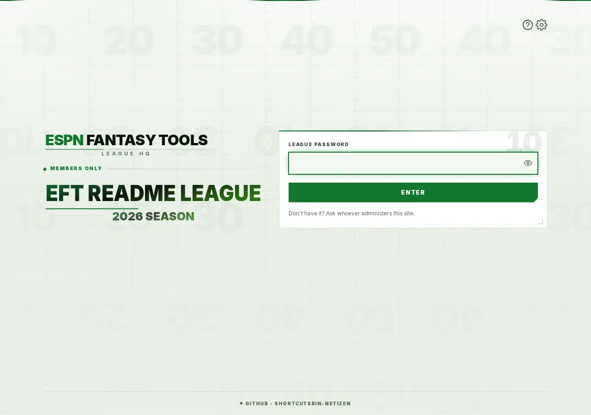
</picture>

**For members**

- Everyone signs in with the same **League Password**, chosen by whoever administers the site.
- **Type it, don't paste it.** The field refuses pasted text on purpose; the eye button shows what you typed.
- **You stay signed in** for as long as the site's **Sign-in length** allows (eight hours unless it has been changed).
- **Several wrong attempts in a row** slow the next ones down for a few minutes.

**For whoever administers the site**

- The second password, the **Admin Password**, opens [Site Configuration](#site-configuration) and any tool set to
  admin-only. It is asked for again every time it is needed rather than kept.
- **Sign-in length** in Site Configuration sets how long a sign-in lasts, from one hour to infinite. A change applies
  from the next sign-in.
- **Changing the League Password signs everyone out**, whatever the Sign-in length, and replaces the Site API key.

### On your phone

The site can sit on your phone's home screen like an app, named **League HQ**, and opens full screen.

- **iPhone or iPad:** open the home page in Safari, tap **Share**, then **Add to Home Screen**.
- **Android:** open the home page in Chrome, open the menu, then **Add to Home screen** (or **Install app**).

<picture>
  <source media="(prefers-color-scheme: dark)" srcset="docs/images/home-phone-dark.webp">
  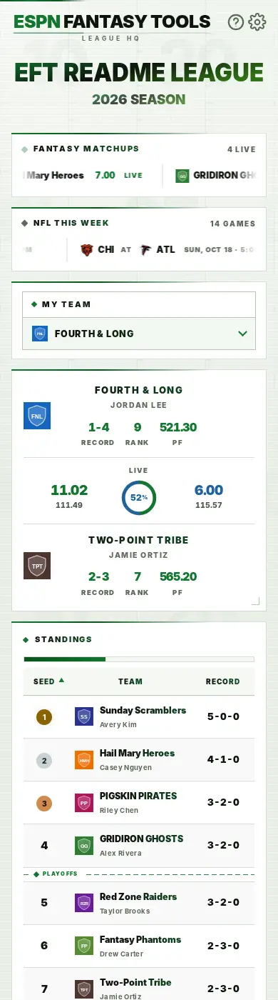
</picture>

---

## The home page

The league at a glance. It follows **your team**: pick it once near the top, and the matchup card, the injury watch
and your row in the standings all follow it. Every tool shares the same choice, so you only make it once.

**For members**

| Part | What it shows |
| --- | --- |
| **Matchups strip** | This week's fantasy matchups: live scores and projections, moving while games are on |
| **NFL strip** | The NFL games behind them, with scores and kickoff times |
| **Your matchup** | This week's score, projection and win chance for you and your opponent, with a countdown to the next kickoff. When a game matters, a banner says why: **Championship**, a playoff round, **Third Place Game**, **Must Win**, **Win and You're In**, **Most Critical Remaining Matchup**, **Top of the Table** |
| **Standings** | The full table, sortable on any column: record, points for and against, streak, ESPN's **Playoff %**, and **Sim %** once [Fortune Teller](#fortune-teller) has run. A **Playoffs** line marks the last playoff place. After the regular season every team reads **Clinched** or **Eliminated** |
| **Tools** | One tile per tool. A tool kept for admins shows a lock |
| **Injury watch** | Injuries on your own roster, using whichever of ESPN's two reports is newer |
| **League activity** | Every completed add, drop and trade, one line per transaction, and every trade offer with where it stands. Starts at the last seven days |
| **Around the league** | Headlines from across the NFL |

- **When the site is updated**, a short note says what changed, once per browser.
- **A note from the Site Admin** appears once, over the page, when whoever administers the site writes one.
- **"Some league data can't be reached"** appears at the top if ESPN stops answering for part of the league's data.
  Pages show the last data the site had until it answers again.

> [!NOTE]
> A waiver claim that hasn't run yet is never shown to anyone, on any page. ESPN keeps them private, and so does this
> site.

**For whoever administers the site**

- Which tiles appear, and in what order, is set in Site Configuration (**Tools**, **Home page order**).
- The **data banner** can be dismissed for everyone with the Admin Password; it comes back only if a check fails three
  hours running again. Site Backend's **Data Layer** tab shows exactly which data is affected.
- If an update needs data the site has never fetched, a banner asks you to pull it from Site Configuration.

---

## On every page: help and settings

Every page has the same two buttons in its top corner.

- **Help (the question mark)** opens a short, numbered guide to that page.
- **Settings (the gear)** holds three choices that apply to you alone, on every page:
  - **Reduce motion** stills the moving background.
  - **Light theme**, for those who must.
  - **Time zone**: every time on the site is shown in the zone you pick, or your device's own.

The **← Back to home** button sits at the foot of every page.

---

## The tools

Each tool can be **Visible** to the whole league, **Admin-only** (listed on the home page with a lock, and opened with
the Admin Password), or **Hidden**. Whoever administers the site chooses, tool by tool.

### Draft Helper

*Live draft board, roster needs and recommended targets.* For the day of the draft.

<picture>
  <source media="(prefers-color-scheme: dark)" srcset="docs/images/draft-helper-dark.webp">
  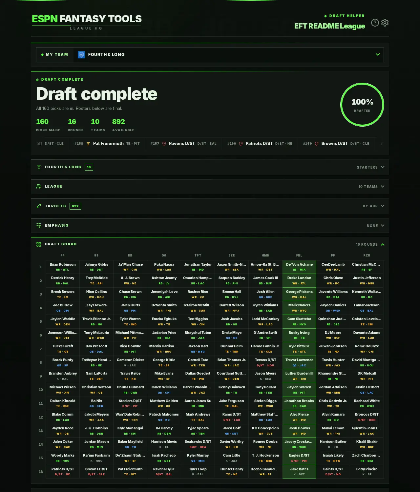
</picture>

**For members**

- **The clock.** Before the draft it counts down; during it, it names who is on the clock and which pick they are on.
- **Your roster and needs**, filled in as you pick, using your league's own lineup slots, bench size and position
  limits (including superflex and leagues without a kicker).
- **Targets.** Every available player in ADP order. Star the ones you want to remember and hide the ones you never
  want to see again; **emphasis** floats one position to the top without hiding the rest.
- **The board.** Every pick of the draft, your own highlighted. Snake and straight drafts both work, and a traded pick
  is shown in its original place with the team that now holds it.

**For whoever administers the site**

- Visible by default. It reads the league's draft from ESPN every 15 seconds while the draft is on.
- Nothing to set up: the board follows your league's own draft settings.

### Live Matchups

*This week's scoreboard, lineups and live win probability.*

<picture>
  <source media="(prefers-color-scheme: dark)" srcset="docs/images/live-matchups-dark.webp">
  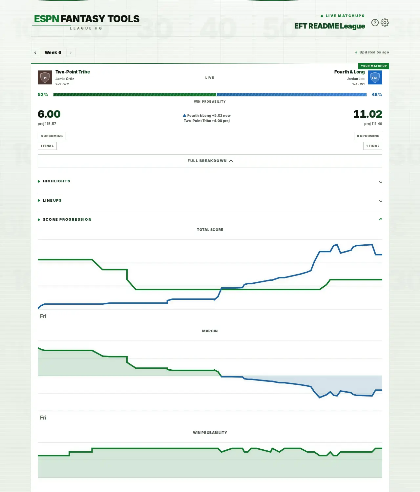
</picture>

**For members**

- **Every matchup this week**, yours first, with a split bar showing ESPN's own win chance as it moves.
- **Full breakdown** opens both lineups player by player (a player whose game is on is lit up with the quarter, the
  clock and the score), scoring by position, the week's booms and busts, the NFL games your players are in, and your
  record against that opponent.
- **The shape of the week.** Score, margin and win chance are recorded every minute of every game. **Point at a chart**
  to read any moment of it. Quiet stretches are squeezed up so the games fill the chart.
- **Look back** through weeks already played with the arrows beside the week.

**For whoever administers the site**

- Visible by default. Scores refresh every 15 seconds during games, recorded by the site's once-a-minute work even when
  nobody has the page open.

### Hall of Fame

*Champions, all-time standings and every team's record.* The league's record book, built from every season it has
played.

<picture>
  <source media="(prefers-color-scheme: dark)" srcset="docs/images/hall-of-fame-dark.webp">
  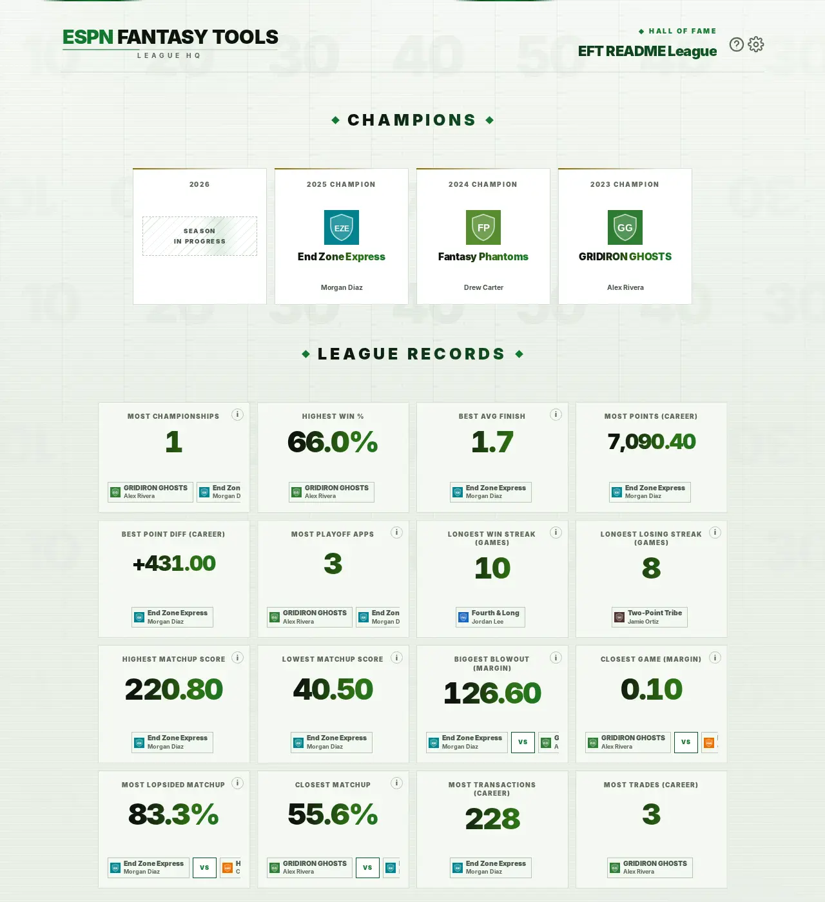
</picture>

**For members**

- **Champions**: one plaque per completed season, newest first.
- **League records**: every all-time superlative (highest and lowest scores, biggest blowouts, closest games, longest
  streaks and more) and who holds it. When teams are tied, all of them are listed.
- **All-time standings**: every team that has ever played in the league, sortable on any column, with the regular
  season and the postseason shown separately.
- **Team records**: open any team for its season-by-season history and its head-to-head record against every other
  team, down to each game.

**For whoever administers the site**

- Visible by default. It needs the league's history, pulled by the setup wizard's last step or by **League history** in
  Site Configuration. A pull can be stopped and resumed, and retries what it missed.

### Fortune Teller

*Every way the rest of the season can go, and where each leaves you.*

<picture>
  <source media="(prefers-color-scheme: dark)" srcset="docs/images/fortune-teller-dark.webp">
  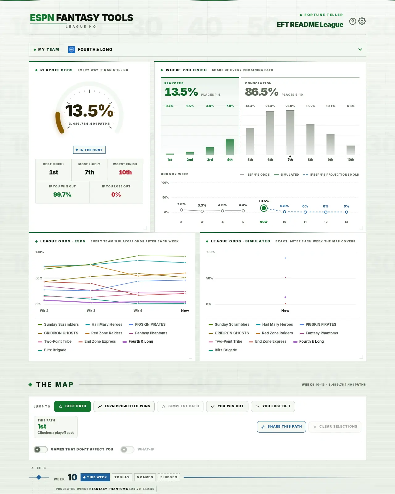
</picture>

**For members**

- Near the end of the regular season, the site counts **every** possible way the remaining games can finish, exactly,
  not by sampling, and shows where each leaves every team.
- **The dial** shows your playoff chances, and the **finish board** your chance of every place from first to last.
- **League odds**: every team's playoff odds after each week, ESPN's and the simulation's side by side. Point at a line
  to read it, or tap a team in the legend to show it alone.
- **The map.** Every remaining game is a switch with three results. **Tap a result to set it**, and every figure
  recounts over only the ways the season can go where that happens.
- **Standings** switch between the table as it stands and the table your selected results would produce.
- **Jumps**: your best path, ESPN's projected winners, the simplest path to a playoff place, winning out and losing out.
- **Share** the exact path you are looking at with a link.
- Before the map can be built, the page shows ESPN's odds and the brackets as they stand; after the regular season it
  becomes a final page with your season's result.

**For whoever administers the site**

- Starts **switched off**. Switch it on once in Site Configuration; from then on it builds the map by itself as soon as
  the league is close enough to the end (for a ten-team league, typically after about week 9), and moves it on each week
  as results come in.
- **Check now** and **Rebuild** in the same panel, with where it stands and how big the build is.

### Trade Analyzer

*Every offer on the table, broken down for both sides.*

<picture>
  <source media="(prefers-color-scheme: dark)" srcset="docs/images/trade-analyzer-dark.webp">
  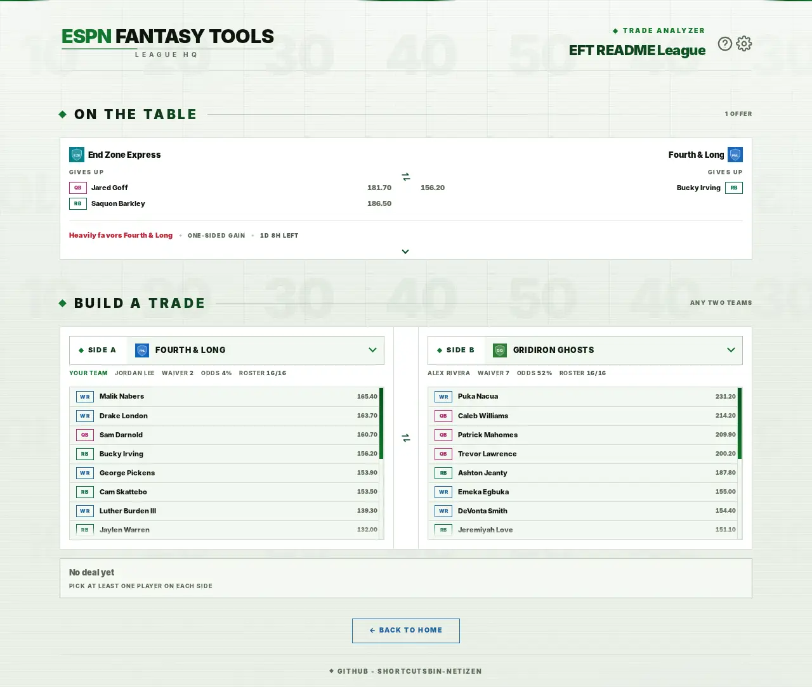
</picture>

**For members**

- **On the table**: every trade proposed in the league and not yet answered, already analysed. Nothing here accepts,
  declines or changes anything in ESPN.
- **Build a trade** between any two teams: tap players on either roster and the verdict follows as you go.
- **Twenty-eight statistics** judge every deal; eleven have a slider you can move for yourself. They read ESPN's
  projections, each week played, byes, depth charts, the free agents available and ESPN's playoff odds.
- **The balance meter** leans toward the side the deal favours; **suggestions** offer up to three changes that bring a
  lopsided deal closer to even.
- **Copy link** hands someone the exact trade on screen.

**For whoever administers the site**

- **Trade Analyzer weighting** in Site Configuration sets what each statistic is worth for your league. Members can
  still move the adjustable ones for themselves; that never changes the league's weighting.

### LLM Data Export

*For those who wish to outsource their thinking.* One file holding the whole league, plus a prompt that tells an AI
chat assistant how to read it.

<picture>
  <source media="(prefers-color-scheme: dark)" srcset="docs/images/llm-export-dark.webp">
  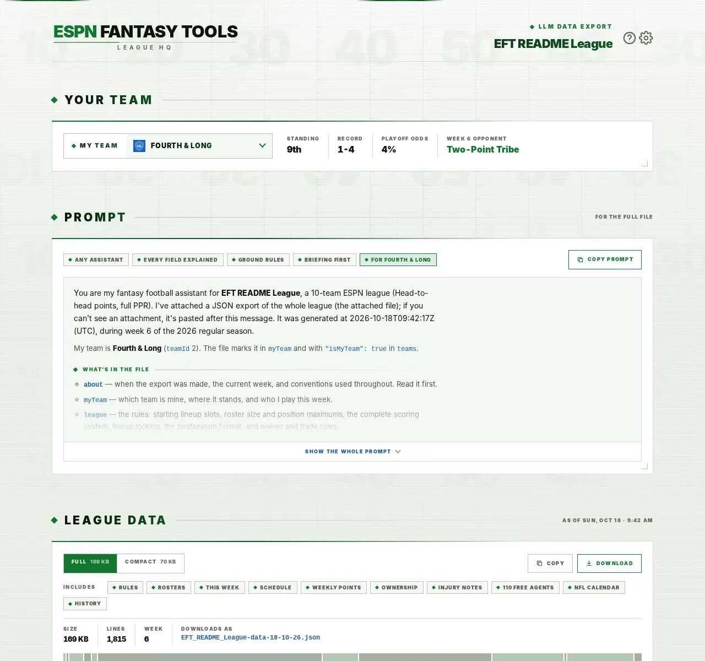
</picture>

**For members**

- **Choose your team** and the file marks it; the prompt is written from your side.
- **Full or compact**: compact keeps what a weekly decision needs at well under half the size.
- **Copy or download**, then paste the prompt into a new chat and attach the file. Each copy or download is brought up
  to date first.

**For whoever administers the site**

- **Never in it**: owner names, passwords, ESPN sign-in details, or pending waiver claims for any team.

### Site API

*Your league's data for spreadsheets, scripts and phones.* A small, read-only way for programs to read the league, and
a page that shows how to use it on the tools people already have.

<picture>
  <source media="(prefers-color-scheme: dark)" srcset="docs/images/site-api-dark.webp">
  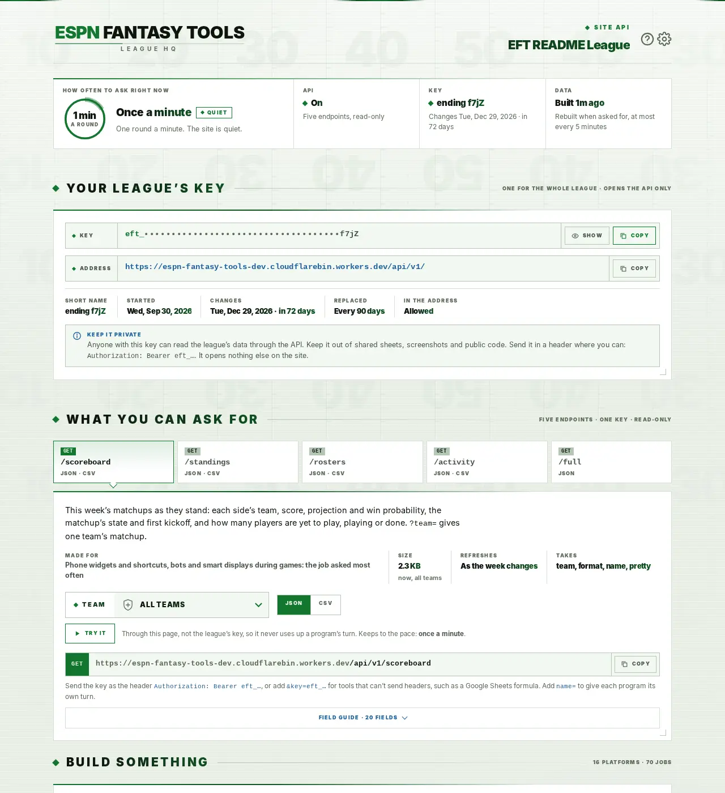
</picture>

**For members**

- **The league's key** opens the API and nothing else on the site. It shows behind dots until you press **Show**.
- **Five addresses** answer everything: the scoreboard, the standings, the rosters, league activity, and one for all
  of it. **Try it** shows exactly what a program gets.
- **Guides for sixteen platforms and seventy jobs**: Google Sheets, Excel, Python, JavaScript, PowerShell, a Mac or
  Linux shell, iPhone and iPad, Android, Home Assistant, Discord or Slack, your calendar, **ntfy** phone alerts,
  Telegram, GroupMe, desk and TV displays, and dashboards and SQL. Close-game alerts, injury changes, notable drops,
  clinched and eliminated posts, weekly awards, a desk scoreboard, a bye-week planner and more. Each job has its steps,
  its code with the key and your team filled in, and a picture of it working.
- **How often to ask.** Programs should ask about once a minute; the site slows that when it is busy and says so in
  every answer. Every example on the page pauses or stops itself when told to.
- **Dataset downloads**: every part of the league's data as a JSON or CSV file. No key needed.

**For whoever administers the site**

- Starts **admin-only**. Make it visible to share it with members, switch the API off, or replace the key from Site
  Configuration. The key is also replaced automatically (every 90 days by default, with a week's notice in every
  answer), and at once when the League Password changes.

### Site Backend

*How the site is running: health, data, traffic, and logs.* A read-only window for whoever administers the site.

<picture>
  <source media="(prefers-color-scheme: dark)" srcset="docs/images/site-backend-dark.webp">
  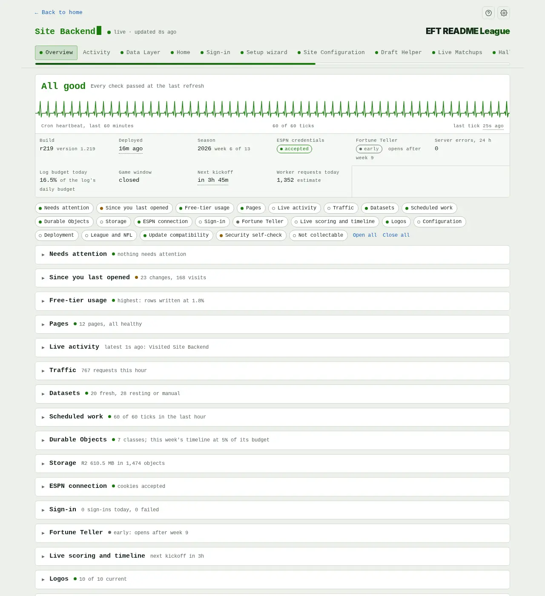
</picture>

**For members**

- Members don't see it unless whoever administers the site makes it visible.

**For whoever administers the site**

- **Overview**: one word for how the site is doing, a heartbeat of the site's once-a-minute work, anything that needs a
  look, and the site's use of its free daily allowance.
- **Activity**: the site's log, and **Visits over time**, a chart by page and by team. Visits and sign-ins name the team
  chosen on that browser and nothing else about a visitor. Errors a browser hits are recorded too.
- **Data Layer**: every part of the league's data, how fresh it is, whether ESPN is answering for it, and which pages
  use it.
- **A tab for every page**: what it reads, who visited, and its part of the log. The Site API tab shows who is asking
  the API how often, by a name like `IPv4:3`, never an address.
- Looking at Site Backend never changes anything. Starts **admin-only**.

---

## Site Configuration

The site's controls, for whoever administers it. The Admin Password is asked for when the page opens and checked again
on every change; nothing stays unlocked after you close the tab. Every panel starts shut: choose its header to open it.

<picture>
  <source media="(prefers-color-scheme: dark)" srcset="docs/images/site-configuration-dark.webp">
  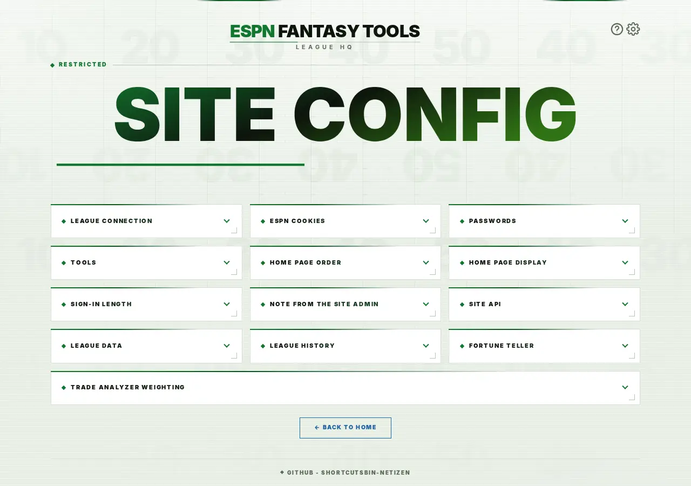
</picture>

| Panel | What you can do |
| --- | --- |
| **League connection** | See which league, season and history the site is pointed at |
| **ESPN cookies** | Replace them when league data stops loading. The site tests them against ESPN before saving |
| **Passwords** | Change the League Password or the Admin Password. Changing the League Password signs everyone out and replaces the Site API key |
| **Tools** | Set each tool to Visible, Admin-only or Hidden. At least one league tool always stays visible |
| **Home page order** | Move tiles up or down; the home page follows at once |
| **Sign-in length** | How long a member stays signed in, from one hour to infinite |
| **Note from the Site Admin** | Write a note for everyone, with bold, italic, the site's colours and links to its pages, and a signature from your saved list. Each browser sees it once |
| **Site API** | Switch the API on or off, replace the key, choose how often it is replaced, and whether it may travel in an address |
| **League data** | Refresh every dataset at once. A pull can be resumed, and finishes with a list of anything it could not fetch, each with a Retry |
| **League history** | Re-pull past seasons for the record book |
| **Fortune Teller** | Switch it on, check it now, or rebuild the map |
| **Trade Analyzer weighting** | What each statistic is worth when Trade Analyzer judges a deal for your league |

---

## The setup wizard

<picture>
  <source media="(prefers-color-scheme: dark)" srcset="docs/images/wizard-dark.webp">
  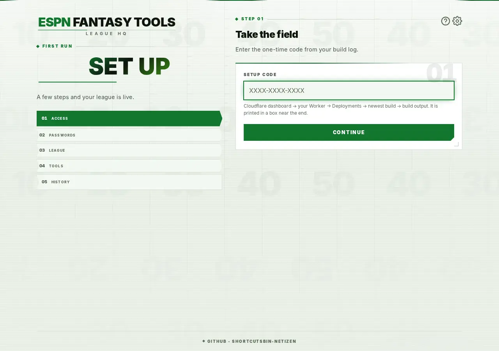
</picture>

The first time the site runs, it opens on a short wizard: a one-time setup code, the two passwords, your ESPN league
(and, for a private league, two cookie values from a signed-in browser), which tools the league sees, and a first pull
of your league's data and history. The [setup guide](setup-guide.md) covers every step. Once it finishes, the wizard
is replaced by the site itself for good.

---

## How it works

<picture>
  <source media="(prefers-color-scheme: dark)" srcset="docs/images/how-it-works-dark.svg">
  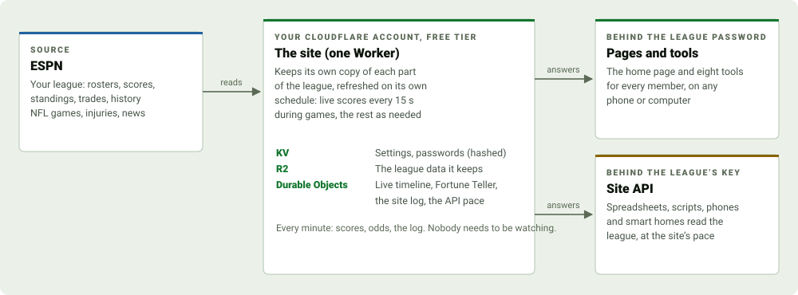
</picture>

**Where the data comes from.** Everything comes from your league on ESPN, read with the league's own sign-in when it
is private. The site keeps its own copy of each part and refreshes it on its own schedule: live scores every fifteen
seconds while games are on, the rest from every few minutes to a few times a day. A page you open is answered from
that copy at once, and brought up to date behind it if it was getting old.

**What the site works out for itself.** Some of what you see exists nowhere on ESPN: how every score and win chance
moved through each game, ESPN's weekly playoff odds (which ESPN cannot show for past weeks, so the site records them),
Fortune Teller's exact odds, the Hall of Fame record book, and Trade Analyzer's breakdowns.

**What runs on its own.** Once a minute the site records live scores, moves Fortune Teller's work along, and checks
itself; once an hour it checks that ESPN is still answering for every part of the league's data.

**Staying free.** The whole site runs within Cloudflare's free allowance. It paces itself, and anything asking through
Site API, to stay there: on a busy day its pages slow down, and only in an extreme would they rest until 00:00 UTC.
The site's own work, live scoring included, carries on regardless. If the Cloudflare account also runs other
websites, they share the same allowance, which is why the setup guide suggests keeping the account to this site alone.

**What stays private.** Passwords are stored scrambled and never sent back to anyone's browser; the league's ESPN
sign-in is only ever sent to ESPN. Pending waiver claims are never shown. Owner names never leave the site through LLM
Data Export or Site API. Site Backend records which pages were visited by the team chosen on that browser, and never
anyone's address or device.

**When something goes wrong.** If pages start coming up empty, the ESPN cookies have most likely expired: replace
them in Site Configuration. The [setup guide](setup-guide.md#if-something-goes-wrong) lists the other common fixes.

---

## Keeping your copy up to date

Your fork syncs with this repository once a day by itself (the **Sync with upstream** workflow you enabled during
setup), and Cloudflare redeploys it. Nothing you have set is lost in an update, and the home page says what changed.
If a sync ever stops with an error, open your fork's page on GitHub and choose **Sync fork**, then **Update branch**.

---

## Questions and issues

- **Email:** [shortcutsbin@gmail.com](mailto:shortcutsbin@gmail.com)
- **GitHub:** [open an issue](https://github.com/shortcutsbin-netizen/espn-fantasy-tools/issues) with what you saw
  and what you expected.
- **Pull requests are welcome** for a fix that is built, tested and verified.

this line is a test edit to attempt to trigger a cloudflare rebuild
